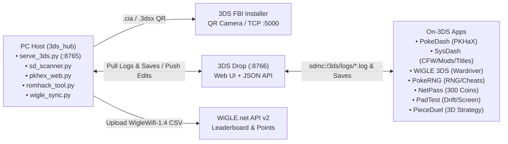

# 3DS Homebrew, PKHaX & Diagnostic Workspace

System-scoped Nintendo 3DS CFW homebrew workspace in this repository (alongside future console directories like `ps3/`, `ps4/`, `vita/`, `xbox360/`, `wiiu/`, etc.) tracked under the [**`lafiabrew`** GitHub Organization](https://github.com/orgs/lafiabrew/repositories).

- **Architecture & Mermaid Ecosystem Diagrams:** [`docs/ARCHITECTURE.md`](docs/ARCHITECTURE.md)
- **Human Step-by-Step Quick-Start & SOPs:** [`docs/SOP.md`](docs/SOP.md)
- **Pocket Field Cheat Sheet (Buttons, Boot Combos & Pokémon TitleIDs):** [`docs/CHEATSHEET.md`](docs/CHEATSHEET.md)
- **Troubleshooting, Crash Dump & `.bak` Recovery Playbook:** [`docs/TROUBLESHOOTING.md`](docs/TROUBLESHOOTING.md)
- **Future Agent Playbook & Multi-Console Blueprint:** [`docs/AGENT_PLAYBOOK.md`](docs/AGENT_PLAYBOOK.md)
- **Agent Operational Guide:** [`AGENTS.md`](AGENTS.md)

## System & Ecosystem Overview



## All 8 Nintendo 3DS Homebrew Apps (`lafiabrew`)

| Project / Repo | Short Title | Short Description | UniqueId | Product Code | Purpose |
|---|---|---|---|---|---|
| `3ds_pieceduel/` | **PieceDuel** | `4-in-a-Row Strategy Game` | `0x0D3E0` | `CTR-P-PD3D` | Stereoscopic 3D shared-trait 4-in-a-row strategy board game (AI, Daily Puzzles, 3DS Local Wireless `nwm::UDS`, LAN P2P, and Web Cross-Play). |
| `3ds_pokedash/` | **PokeDash** | `Pokemon Save Editor` | `0x0D3E1` | `CTR-P-PKDS` | Permissive **PKHaX Save Inspector & Surgical Editor** for Gen 3–7 & custom ROM hacks (`Checkpoint`, `TWiLightMenu++`, `open_agb_firm`/GBA) + Type/Nature/Hidden Power/Shiny calculator. Writes `<save>.bak` first and recalculates CRC-16-CCITT (`BEEF`) & Gen 3 section checksums. |
| `3ds_sysdash/` | **SysDash** | `System & Mod Manager` | `0x0D3E2` | `CTR-P-SYSD` | Live 3DS battery/Wi-Fi/IP/SD inspector (`ptm:u`, `soc:u`), **1-button Luma3DS LayeredFS ROM-hack toggler** (`luma/titles/<TitleID>` ↔ `titles_disabled`), and **crash dump / log snapshotter** (`luma/errdisp.txt`, ARM11 `.dmp`). |
| `3ds_drop/` | **3DS Drop** | `Wireless SD File Server` | `0x0D3E3` | `CTR-P-DROP` | Wireless LAN HTTP/JSON server (`:8766`) that displays your live **3DS IP address** on-screen and lets your PC scan the SD card, pull crash logs, and push/pull up to 1 MB saves/ROMs with `.bak` backup and `..` traversal rejection. |
| `3ds_wigle/` | **WiGLE 3DS** | `WiFi Wardriver & Radar` | `0x0D3E4` | `CTR-P-WIGL` | 2.4 GHz Ch 1–13 spectrum analyzer (`ac:u` + `nwm::UDS` beacon scanner) that logs official **`WigleWifi-1.4` CSV** wardriving sessions (`sdmc:/3ds/wigle/wigle_3ds_session.csv`). |
| `3ds_rngtool/` | **PokeRNG** | `RNG & Cheat Generator` | `0x0D3E5` | `CTR-P-PRNG` | Calculates Trainer Shiny Value (`TSV`) & Gen 7 `G7TID`, searches LCRNG (`0x41C64E6D * seed + 0x6073`) frames for Shiny / 6×31 IV spreads, and generates **Luma3DS Rosalina `cheats.txt`** files (`sdmc:/luma/titles/<TitleID>/cheats.txt`). |
| `3ds_netpass/` | **NetPass** | `Play Coins & StreetPass` | `0x0D3E6` | `CTR-P-SPAS` | 1-button **300 Play Coin Maxer** (`gamecoin.dat` with `.bak` backup), Pedometer step reader (`ptm:u`), and StreetPass `CECD` inbox/outbox archiver (`sdmc:/3ds/netpass/boxes/`). |
| `3ds_padtest/` | **PadTest** | `Stick Drift & Screen Tester` | `0x0D3E7` | `CTR-P-PADT` | Circle Pad min/max excursion & rest-drift % analyzer, recommended deadzone calculator, full-screen dead-pixel test patterns (`R`/`G`/`B`/`W`/`K`), and `hardware_report.json` exporter. |
| `pc_companion/` + `serve_3ds.py` | **3DS Hub (`3ds_hub`)** | Host Deployment & Companion Suite | Host | Host | Universal **FBI QR & Network Installer Hub** (`serve_3ds.py` on `:8765`), wireless/local SD & crash log scanner (`sd_scanner.py`), PC PKHaX editor (`pkhex_web.py`), and `.ips`/`.bps` ROM patcher (`romhack_tool.py`). |

---

## Quick Start Commands

```bash
# Build & verify all 8 3DS homebrew apps (host ASan/UBSan tests + ARM11 .elf/.smdh/.3dsx/.cia)
make all

# List all 8 discovered 3DS homebrew packages
make list

# Launch the Universal FBI QR & Network Installer Hub on :8765
python3 serve_3ds.py

# Wirelessly scan your 3DS SD card & harvest all app logs (sdmc:/3ds/logs/*.log + Luma dumps)
python3 pc_companion/sd_scanner.py --url http://<3ds-ip-shown-in-3ds-drop>:8766 --dump-logs ./sd_logs

# Upload 3DS WiGLE wardriving CSVs to wigle.net for leaderboard points & sync rank back to 3DS
export WIGLE_API_NAME="AID_your_api_name"
export WIGLE_API_TOKEN="your_api_token"
python3 pc_companion/wigle_sync.py --url http://<3ds-ip-shown-in-3ds-drop>:8766
```
