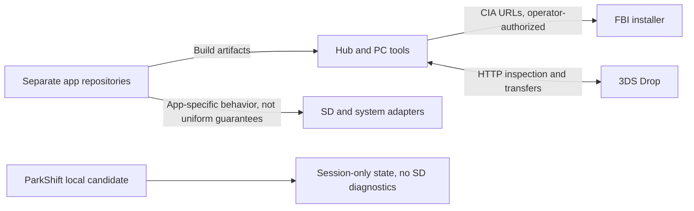

# Nintendo 3DS homebrew workspace

**Public Nintendo 3DS page:** <https://lafiabrew.github.io/3ds_hub/>. This page is static 3DS documentation, not a release catalog for every console or a remotely running SD/installer service. LAN operations still require the local PC/console programs.

Games, experimental utilities and PC companion tools for the `lafiabrew` organization. This is the **hub repository**; app directories are separate repositories. A folder, passing host test, packaged CIA or reachable GitHub link is **not a hardware-verified release**.

> **Read [current status and safety limits](docs/STATUS.md) before touching saves, uploading observations, generating cheats or deleting titles.** Some earlier descriptions overstate compatibility, backup guarantees and system integration. Existing `AGENTS.md` files and historical audits have not all been corrected; they are not evidence that these features are safe.

## Documentation

- [Documentation index](docs/README.md)
- [Current capabilities, limitations and evidence](docs/STATUS.md)
- [Architecture and data boundaries](docs/ARCHITECTURE.md)
- [Setup and safe inspection procedures](docs/SOP.md)
- [Short command and control reference](docs/CHEATSHEET.md)
- [Troubleshooting without destructive shortcuts](docs/TROUBLESHOOTING.md)
- [Agent/maintainer accuracy checklist](docs/AGENT_PLAYBOOK.md)
- [Pages privacy, diagram and accuracy audit](docs/audit/2026-11-03-pages-privacy-and-rendering.md)
- [Historical audit index](docs/audit/README.md)
- [Project constitution: required invariants, not certification](specs/CONSTITUTION.md)

## Workspace inventory

The root [Makefile](Makefile) selects **16 projects**. The first 16 rows below describe that build membership, not release acceptance. UniqueIds/product codes come from each app's `meta/app.rsf`; full installed TitleIDs must be checked in the actual package. Other local work-in-progress directories may exist.

| Project | Source-level purpose / boundary | UniqueId | Product code |
|---|---|---|---|
| `3ds_pieceduel/` | Shared-trait four-in-a-row game; networking/device paths need their own evidence. | `0x0D3E0` | `CTR-P-PD3D` |
| `3ds_pokedash/` | Pokémon calculators and experimental PKHX save-block editing; not verified general native-save support. | `0x0D3E1` | `CTR-P-PKDS` |
| `3ds_sysdash/` | Telemetry, mod-directory operations and title-management code; deletion is not an icon-repair prerequisite. | `0x0D3E2` | `CTR-P-SYSD` |
| `3ds_drop/` | HTTP SD inspection/transfer server on port 8766; replacement/backup guarantees are incomplete. | `0x0D3E3` | `CTR-P-DROP` |
| `3ds_wigle/` | Wi-Fi/UDS display and CSV experiments with synthetic/default fields; not submission-ready wardriving data. | `0x0D3E4` | `CTR-P-WIGL` |
| `3ds_rngtool/` | TSV/G7TID and Method-1 LCRNG calculations; fixed cheat templates are not validated per-game codes. | `0x0D3E5` | `CTR-P-PRNG` |
| `3ds_netpass/` | App-local coin-file and seeded box-summary experiments; actual system coin/CECD integration unverified. | `0x0D3E6` | `CTR-P-SPAS` |
| `3ds_padtest/` | Input excursion/drift display, screen patterns and report exporter; physical calibration unverified. | `0x0D3E7` | `CTR-P-PADT` |
| `3ds_picross/` | Small built-in nonogram puzzle set and clue routines, not a general puzzle solver. | `0x0D3E8` | `CTR-P-PICR` |
| `3ds_sandlab/` | Falling-sand grid simulation; no measured console frame-rate claim here. | `0x0D3E9` | `CTR-P-SAND` |
| `3ds_chip8/` | CHIP-8 interpreter/debugging prototype; ROM/quirk compatibility needs separate tests. | `0x0D3EA` | `CTR-P-CHP8` |
| `3ds_solitaire/` | Klondike-style tableau/foundation rules; not a demonstrated complete solver or FreeCell implementation. | `0x0D3EB` | `CTR-P-SOLI` |
| `3ds_pokedex/` | Small curated Pokémon stat/ability list, not a complete generation-spanning database. | `0x0D3EC` | `CTR-P-PKDX` |
| `3ds_sokoban/` | Crate-pushing levels and undo; solution quality/progression require app-specific evidence. | `0x0D3ED` | `CTR-P-SOKO` |
| `3ds_roulette/` | European single-zero 0–36 model; no 00/000 variants in the inspected implementation. | `0x0D3EE` | `CTR-P-ROUL` |
| `3ds_mahjong/` | Layered tile-pair removal and available-pair hints; a hint is not a full solvability proof. | `0x0D3EF` | `CTR-P-MAHJ` |
| `3ds_parkshift/` | **Separate local candidate**, outside root build membership: Slide + Jam, session-only, hardware acceptance pending. | `0x0D400` | `CTR-P-PARK` |

`serve_3ds.py` discovers existing CIA/3DSX packages dynamically. Discovery can include projects outside `PROJECTS`, omit unbuilt projects, or find stale artifacts. QR indices are discovery-dependent, not permanent app IDs. ParkShift has no public repository/release asserted here; its README is in the separate local app checkout.

## Safe local checks

Run from this hub directory, with Python 3 and the app checkouts/artifacts available. The first command checks the existing hub's local discovery/HTTP/QR path; it does not install anything.

<!-- check: local-smoke -->
```sh
python3 serve_3ds.py --self-test &&
python3 serve_3ds.py --list
```

Expected: self-test exits 0 and the second command lists packages actually found. Printed descriptions can retain overstated package metadata (for example “Auto-Solver”); they are not feature-validation results. Empty output is not proof of a successful build. See [setup](docs/SOP.md) if app repositories or the toolchain are absent.

**Known build-gate defect:** root `make 3ds` and `make verify-3ds` can conceal an earlier child failure. Do not treat root `make all` exit 0 as fleet acceptance. Use explicit per-app commands and inspect their statuses; [STATUS](docs/STATUS.md) records the still-open remediation.

For a publicly available app checkout, for example PadTest:

```sh
make -C 3ds_padtest test &&
make -C 3ds_padtest 3ds &&
make -C 3ds_padtest verify-3ds
```

This requires its existing toolchain image and is not clean-machine provisioning or physical-device acceptance. No install or push is part of these commands. The root aggregate does not include ParkShift.

## Architecture at a glance



Do not expose the unauthenticated LAN installer or SD-transfer helpers to an untrusted network. Public profile edits and releases require their own review; this documentation update does not publish or certify any app.
