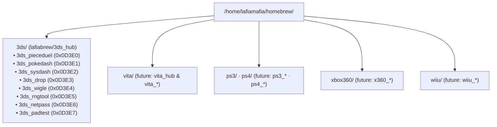

# Future Agent Playbook & Multi-Console Blueprint (`docs/AGENT_PLAYBOOK.md`)

This playbook captures every hard-won hardware, compiler, binary-format, and networking invariant from building the `lafiabrew` Nintendo 3DS suite so future coding agents extending `3ds/` or scaffolding new console directories (`/home/lafiamafia/homebrew/ps3/`, `ps4/`, `vita/`, `xbox360/`, `wiiu/`) never repeat a past pitfall.

---

## 1. Multi-Console Directory & Repository Convention (`lafiabrew`)

### Naming & Isolation Rules:
1. **System Directory (`<console>/`)**: Holds the root deployment server (`serve_<console>.py`), `pc_companion/`, and `Makefile`, tracked in `lafiabrew/<console>_hub` with `<console>_*/` in `.gitignore`.
2. **Standalone App Directories (`<console>_<app>/`)**: Each app is its own independent Git repository pushed to `https://github.com/lafiabrew/<console>_<app>`.
3. **Dual-Target C11 Abstraction**:
   - Every app defines a thin platform header (`pk_platform.h`) with two implementations:
     - `src/platform_host.c`: Software framebuffer + input injection for sub-second Linux host unit & UI simulation tests under `-Wall -Wextra -Werror -fsanitize=address,undefined`.
     - `src/platform_<console>.c`: Hardware GPU/input/network implementation compiled inside a rootless Podman toolchain container.

---

## 2. Seven Critical Nintendo 3DS Hardware & Binary Gotchas (Must Read)

### Gotcha 1: `smdhtool` Creates Black-Square `.cia` Icons Unless Patched
- **Cause**: `devkitPro`'s `smdhtool` is designed for `.3dsx` (Homebrew Launcher) and writes `0xA0` into all 16 age-rating bytes (`+0x2008..0x2017`), `0xFFFFFFFF` into `region_lockout` (`+0x2018`), and `0x00000141` into `flags` (`+0x2028`). When packaged into a `.cia`, the 3DS HOME Menu rejects `0xA0` age ratings and renders a **black square**.
- **Rule**: Always run `patch_smdh_for_cia()` (`meta/generate_bnr_shared.py`) after `smdhtool` to zero `+0x2008..0x2017`, set `region_lockout = 0x7FFFFFFF`, and set `flags = 0x00000105` (`Visible | RecordUsage | NoSaveBackups`).

### Gotcha 2: `CBMD` `banner.bnr` `cwav_offset` (`+0x84`) Must Be 32-Byte (`0x20`) Aligned
- **Cause**: In a 3DS `CBMD` banner file, the compressed CGFX chunk starts at `0x88` and the `BCWAV` audio chunk starts at `cwav_offset` (`+0x84`). If `cwav_offset % 0x20 != 0`, the HOME Menu fails to parse the banner.
- **Rule**: Pad the LZ11-compressed CGFX output until `(0x88 + len(comp_cgfx)) % 0x20 == 0`.

### Gotcha 3: 3DS Banner CGFX Texture Row Order Is Top-to-Bottom (`yy = y`)
- **Cause**: While raw PICA200 textures often flip `Y`, the UV coordinates in the standard 3DS HOME Menu banner `CGFX` model map `y = 0` to the top edge of the banner. Flipping `yy = 127 - y` renders the banner upside-down.
- **Rule**: Keep `yy = y` in `encode_rgba_to_3ds_rgba4444_morton()`.

### Gotcha 4: 3DS HOME Menu `IconCache.dat` Caches Icons by `UniqueId`
- **Cause**: Reinstalling a `.cia` with the same `UniqueId` in `meta/app.rsf` does not refresh the icon cached in `IconCache.dat` unless the old title is deleted first (or `IconCache.dat` is rebuilt with `L + R + Down + B` on boot).
- **Rule**: Keep SMDH titles short (`<= 12` chars) and descriptions concise (`<= 28` chars), and use `SysDash` (`SELECT` or `TITLES:R`) to delete old test Title IDs cleanly via `am:u` (`AM_DeleteUserTitle` + `AM_DeleteTitle` + `AM_DeleteTicket`).

### Gotcha 5: `citro2d` System Font Is 30px Tall (`~18px` Wide per Character at `1.0x`)
- **Cause**: Drawing a 50-character line at `scale = 0.5f` produces a ~450px line that clips off both the `400×240` top screen and `320×240` bottom screen.
- **Rule**: In `pk_draw_text()` (`platform_3ds.c`), always inspect `ct.width` after `C2D_TextParse()` and clamp `sx = avail_w / ct.width` when `ct.width * sx > (screen_w - x - 6.0f)`.

### Gotcha 6: `soc:u` TCP `Connection reset by peer` on Immediate `close(cfd)`
- **Cause**: Calling `close(cfd)` immediately after `send()` on the 3DS `soc:u` stack aborts the in-flight 2.4 GHz Wi-Fi transmit buffer with a `TCP RST`.
- **Rule**: Combine HTTP headers + body into a single buffer, send in `<= 1024`-byte chunks, call `shutdown(cfd, SHUT_WR)`, drain `POLLIN` briefly, and only then call `close(cfd)`.

### Gotcha 7: GCC 13+ `FORTIFY_SOURCE` + ASan Struct-Pointer Inlining Warning
- **Cause**: Passing `&out->entries[out->count++].field` directly into `snprintf()` under `-O2 -Werror -fsanitize=address,undefined` triggers a spurious `-Werror=format-truncation` ("null destination pointer") in GCC's fortified inliner. And on `arm-none-eabi-gcc`, `uint32_t` is `unsigned long`, so `%u`/`%X` requires an explicit `(unsigned)` cast.
- **Rule**: Populate a stack-local struct `entry` first, then assign `out->entries[idx] = entry`, and cast `uint32_t` arguments to `(unsigned)` in `snprintf`.
