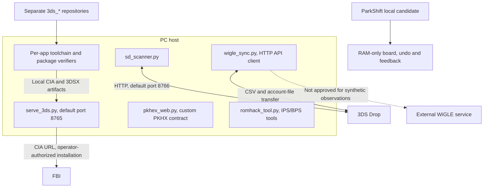
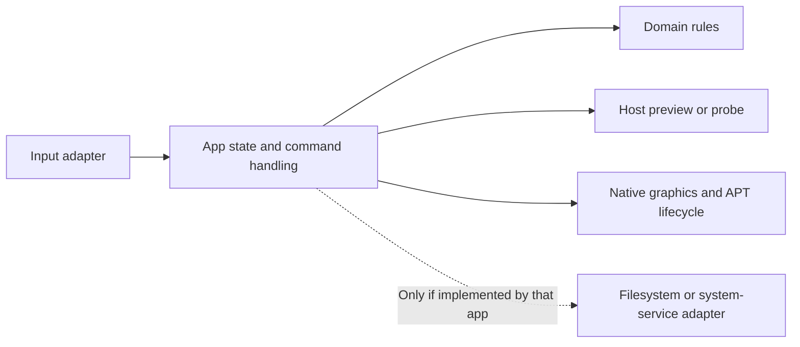

# Architecture and implementation boundaries

Read [current status](STATUS.md) before interpreting this map. It describes local components and intended connections, **not an end-to-end acceptance result**. App repositories, the hub and the organization profile have independent Git histories.

## Workspace and deployment

The root Makefile currently selects 16 projects. Discovery walks existing package files and can find more or fewer; stale files may remain after a failed build. QR indices are generated from discovery order, not a fixed fleet range. A CIA is an installable package; a 3DSX is a Homebrew Launcher executable, not an FBI CIA install.

## Application/platform boundary

Apps commonly split C domain/UI logic from host and libctru/citro2d adapters. Header names, feature coverage and cleanup vary; there is no universal `pk_platform.h` contract across every app. Host renderings approximate the native font and GPU path.

ParkShift uses `app_step`, `parking.c` and separate platform adapters. It intentionally has **no SD persistence or network behavior**. Host bounds/gesture tests and legacy-compatible package flags do not replace physical font, touch, HOME or lid tests.

## Data-safety boundaries

- **Save editor:** Python expects a private PKHX block; the native loader has a synthesized fallback. Preserving bytes outside one fixed range is not proof of correct native Pokémon decoding or safe ROM-hack edits. No real-save editing journey is approved by these docs.
- **File replacement:** the shown Drop and utility writers use temporary-file/rename patterns with incomplete backup/error checking. A host replacement pattern must not be described as guaranteed native atomic recovery. The [constitution](../specs/CONSTITUTION.md) is a requirement, not evidence that each writer conforms.
- **Diagnostic logs:** several native adapters append directly. The approved LinkLab diagnostic-log journal exception does not certify those adapters or relax save/configuration rules. ParkShift does not emit an app log.
- **System integration:** app-local NetPass files and text box summaries do not establish native system coin changes or CECD backup/restore.
- **External data:** a structurally valid WiGLE CSV can still contain synthetic/default identifiers or locations. HTTP success and upload points were not established here.

See the [source-linked status table](STATUS.md) rather than assuming a common guaranteed persistence flow.

## Build/package boundary

Each app's `Makefile`, `meta/app.rsf`, asset helper and verifier define its actual pipeline. Flags, SMDH patches and CBMD layouts must be checked against the produced artifact, not copied from a diagram. Keep a matching unstripped ELF for diagnosis. Report measured sizes with source/artifact hashes; no universal optimization percentage or black-square prevention guarantee is asserted.

Root aggregate native build/verify status is currently unreliable after an early child failure. Explicit chained per-app commands preserve that command boundary; compilation still does not establish console acceptance. [Setup and safe examples](SOP.md) explain the origins and prerequisites.
