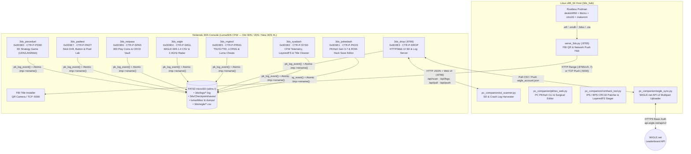
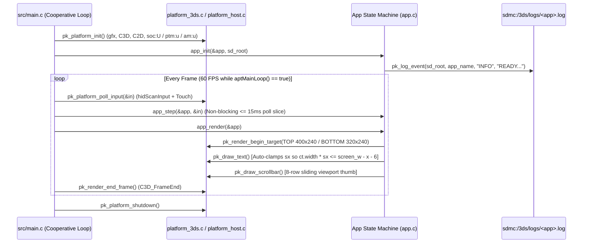
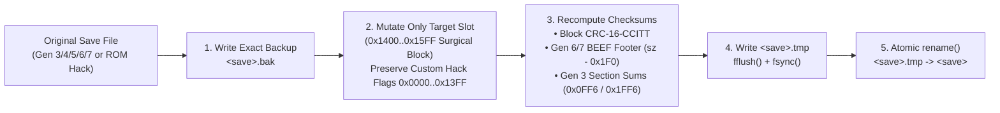

# Architecture & Ecosystem Map — `lafiabrew` Nintendo 3DS Suite

This document provides future coding agents and maintainers with the complete architectural model, data-flow diagrams (Mermaid), memory/persistence invariants, and binary layout across all 9 `lafiabrew` Nintendo 3DS repositories.

---

## 1. Multi-Console Workspace & `lafiabrew` Repository Topology

The `/home/lafiamafia/homebrew/` parent directory is organized by target console family (`3ds/`, and future `ps3/`, `ps4/`, `vita/`, `xbox360/`, `wiiu/`). Inside `3ds/`, `3ds_hub` is the root deployment & PC companion repository, while each `3ds_*` subdirectory is an independent, self-contained C11 homebrew repository:

---

## 2. Dual-Target C11 Platform Abstraction (`pk_platform.h`)

Every 3DS app compiles from the **exact same C11 application/domain source files** (`src/*.c`) to two targets:
1. **Linux Host (`src/platform_host.c`)**: Software rasterizer (`fb_top_l[400*240]`, `fb_bot[320*240]`) + input injection harness compiled with `gcc -std=c11 -Wall -Wextra -Werror -O2 -fsanitize=address,undefined` so every frame, button press, touch event, and file operation is verified under ASan/UBSan in `< 0.2s`.
2. **Nintendo 3DS ARM11 (`src/platform_3ds.c`)**: Hardware PICA200 GPU rendering via `citro3d` / `citro2d` (`C2D_DrawRectSolid`, `C2D_DrawText`) with **automatic text width clamping** (`avail_w / ct.width`) so text never clips on either screen (`400×240` top, `320×240` bottom) across Old 3DS, 2DS, and New 3DS XL.

---

## 3. Surgical PKHaX Save Editing & Atomic Persistence Flow

To guarantee **zero corruption on custom Pokémon ROM hacks** (Drayano hacks, CFRU/decomp GBA hacks, Luma3DS LayeredFS 3DS hacks), `3ds_pokedash` and `pc_companion/pkhex_web.py` never re-serialize unknown save blocks:

---

## 4. CIA / SMDH / CBMD Packaging & Binary Optimization Pipeline

All 8 apps build inside `localhost/pieceduel-3ds-toolchain:latest` without requiring external `bannertool` shared libraries:
- **Compiler & Linker Flags**: `-Os -flto -fomit-frame-pointer -ffunction-sections -fdata-sections -Wl,--gc-sections` followed by `arm-none-eabi-strip --strip-debug`, shrinking ARM11 `.elf` binaries by **~78%** (`1.5 MB` → `~280–366 KB`).
- **SMDH HOME Menu Patch (`patch_smdh_for_cia`)**: Clears `smdhtool`'s `0xA0` age-rating bytes (`+0x2008..0x2017`) to `0x00`, sets region-free lockout (`0x7FFFFFFF` at `+0x2018`), and sets `0x00000105` flags (`+0x2028`) so the 3DS HOME Menu never renders black-square icons.
- **CBMD 3D Banner (`write_cbmd_bnr`)**: Encodes each app's 256×128 RGBA banner into PICA200 Morton-swizzled RGBA4444 tiles (`0x1580..0x11580`), compresses the 71,040-byte CGFX using a 4 KB hash-chain LZ11 encoder padded to a strict **32-byte (`0x20`) boundary** at `cwav_offset` (`+0x84`), and appends the BCWAV audio chime.
