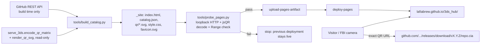

# Installing lafiabrew 3DS homebrew from the hub

Canonical site: **https://lafiabrew.github.io/3ds_hub/**

> **Status of this document and feature (P1 candidate, 2026-11-03).** The static
> catalogue, its builder, probe, tests and Pages workflow exist as an *unreviewed
> author candidate*. They have **not** been independently reviewed, merged, run in
> GitHub Actions, or deployed. The page currently live at that URL is the older
> README-style site, not this catalogue. Nobody has installed anything from this
> catalogue on a physical 3DS. Treat everything below as the intended behaviour
> that reviewers must verify.

## 1. What “Published” means (evidence tiers)

The hub keeps these tiers separate. A card never implies a higher tier than it has.

| Tier | Meaning | Shown by the catalogue? |
|---|---|---|
| Source / WIP | Code exists in a public `3ds_*` repository. | Yes: every card links its source. Cards without an installable release are **Source only** with a reason. |
| CI configured | The repository contains a release workflow. | No. Not inferred. |
| CI executed | A real GitHub Actions run built/tested that exact source. | No. Not inferred. |
| Reviewed | Independent review approved that exact source. | No. Not inferred. |
| **Published** | A public, non-draft, non-prerelease GitHub release `vX.Y.Z` carries exactly one `<repo>.cia` at its direct versioned download URL. | **Yes** — the only tier that unlocks a QR code and download button. |
| Physically tested | Someone observed FBI install and launch on real hardware. | No. Every card says “not observed by this catalogue”. |

The sixteen current `v1.0.0` releases are **legacy** releases: they have no
`SHA256SUMS` or `release.json`. Their cards say so and show the SHA-256 that GitHub
reports for the uploaded file. They are *Published*, not reviewed, CI-built or
hardware-certified.

## 2. Install (FBI Remote Install, QR)

Requirements: a 3DS with custom firmware and [FBI](https://github.com/Steveice10/FBI), Wi-Fi with internet access.

1. Back up your SD card's save data first if you already have the app (see §4).
2. On the 3DS open **FBI → Remote Install → Scan QR Code**.
3. Point the camera at the app's QR code on the hub page and confirm the install.
4. Return to the HOME Menu; the app appears as a new title.

The QR code and the **Download** button on a card contain the *identical* URL, e.g.
`https://github.com/lafiabrew/3ds_chip8/releases/download/v1.0.0/3ds_chip8.cia`.
It is the file itself, at an immutable version path — never a release web page, a
`/latest/` alias, an HTML/meta-refresh redirect or a JavaScript link. GitHub then
redirects the download to its file storage over HTTPS. Whether a particular FBI
build follows that HTTPS redirect has **not** been observed by this project on a
console; if the scan fails, use the manual route below.

**Manual route (no camera / no direct download):** tap/click **Download** on a
computer or phone, copy the `.cia` to the SD card, then in FBI choose **SD → (file)
→ Install CIA**. Optionally verify the file first (§6).

## 3. Update

New versions appear on the hub at the next rebuild (§7), not instantly.

1. Back up save data (§4) and keep the `.cia` you currently have.
2. Scan the new version's QR code (or install the downloaded `.cia`) exactly as in §2.
   Installing a CIA with the same title over an existing one replaces the program;
   save data is normally kept, but that is not verified by this project, so rely on
   your backup.

## 4. Back up

- **Save data:** use a save manager such as Checkpoint or JKSM to back up the app's
  save before every update, rollback or uninstall. Apps that keep their own files on
  the SD card (for example under `sdmc:/3ds/<app>/`) can be copied with a PC.
- **Installed version:** keep the `.cia` you installed. Every version also stays
  available at its own versioned URL on the app's Releases page.

## 5. Roll back

1. Open the app's **Release notes / Releases** link and pick the older version.
2. Install that version's `<repo>.cia`. The hub shows a QR code only for the latest
   stable version, so use the older version's download URL or the manual route in §2.
3. If FBI refuses to install over a newer version, delete the title in **FBI →
   Titles → (app) → Delete Title**, then install the older CIA. Deleting a title can
   delete its save data; restore it from your backup afterwards.

## 6. Verify a download (optional)

- Legacy release: compare `sha256sum <repo>.cia` with the SHA-256 shown on the card
  (GitHub's reported digest for the uploaded file).
- New-contract release: the card links `SHA256SUMS` and `release.json` and shows the
  source commit. The builder already checked that both manifests, the uploaded size
  and GitHub's digest agree; if they disagree the card is downgraded to Source only.

## 7. How the catalogue is built



**Selection rules** (per public, non-archived `lafiabrew/3ds_*` repository except `3ds_hub`):

1. Take releases that are published, not drafts, not prereleases.
2. If any of those has a tag that is not strict `vMAJOR.MINOR.PATCH`, the latest
   version is ambiguous → Source only.
3. Take the highest SemVer. Older releases are never used as a fallback.
4. It must have exactly one `.cia` asset, named exactly `<repo>.cia`, fully uploaded,
   non-HTML, with download URL exactly
   `https://github.com/lafiabrew/<repo>/releases/download/<tag>/<repo>.cia`.
   Foreign hosts, `http:`, `javascript:`, `/latest/`, release pages and path tricks
   are rejected.
5. If `SHA256SUMS` or `release.json` exists, both must exist and agree with each other,
   the uploaded size and GitHub's digest. `release.json` must name the release tag, a
   full 40-hex `source_sha` and the full repository `lafiabrew/<repo>` exactly as the
   release kit writes it (a bare `<repo>`, another owner or another repository is a
   mismatch). The `source_sha` is shown as declared by the manifest; the catalogue does
   not re-resolve the tag to a commit.

Otherwise the card is **Source only** and states why. All repository/release text is
plain text, HTML-escaped and length-limited.

**Refresh** — the `Pages catalogue` workflow runs on pushes to `main` that touch the
catalogue files, on manual dispatch, and hourly at minute 17. Releases in other
repositories therefore show up within about an hour (eventual, not instant; GitHub
may delay scheduled runs and disables schedules in repositories without activity for
60 days, after which a manual run re-enables them). There is no cross-repository
dispatch and no extra token.

**Failure behaviour** — the builder allows a 10-second timeout per request, at most
two retries, at most ten pages / 1000 repositories per listing and 400 requests in
total; it waits for a rate limit only if the reset is within 30 seconds. Any
timeout, rate limit, HTTP error, malformed/truncated JSON, pagination overflow,
foreign pagination/redirect, empty or partial listing makes the build exit 1. In
the workflow that stops before deploy, so the last good deployment stays live
(before the first successful deployment nothing new is published). Locally, an
existing output directory is replaced only atomically after success.

**Security** — no JavaScript; a Content-Security-Policy meta tag with
`default-src 'none'`; no third-party QR service, fonts, analytics or trackers;
generated initials icons only; no application binaries are copied into the site. The
workflow's `GITHUB_TOKEN` (contents: read) is sent only to `api.github.com`, never
forwarded on redirects, and the builder fails if it appears in any output file.
Deployment uses a separate job with only `pages: write` and `id-token: write`; pull
requests never trigger it. Actions are pinned to full commit SHAs resolved from the
GitHub API.

## 8. Maintainer commands

```sh
# Tests: real captured API fixtures, failure oracles, independent QR decoding
python3 -m unittest discover -s tests -p test_catalog.py -v
# Build from the live public API (optional GITHUB_TOKEN raises the rate limit)
python3 tools/build_catalog.py --organization lafiabrew --output _site --base-path /3ds_hub/
# Serve _site on loopback under /3ds_hub/, decode every QR, Range-check every CIA
python3 tools/probe_pages.py --directory _site --base-path /3ds_hub/ --minimum-installs 16
# After a deployment: probe the live site the same way
python3 tools/probe_pages.py --url https://lafiabrew.github.io/3ds_hub/ --minimum-installs 16
actionlint .github/workflows/pages.yml
```

`build_catalog.py` options: `--organization` (required), `--output` (required;
refuses the repository root, source folders and non-empty directories it did not
create), `--base-path` (required, e.g. `/3ds_hub/`), `--api-url` (default
`https://api.github.com`; loopback `http://127.0.0.1:PORT` only, for tests),
`--timeout` (≤ 10 s), `--minimum-repositories` (default 1). Exit 0 success, 1 build
failure, 2 usage error.

`probe_pages.py` options: `--directory DIR` with `--base-path`, or `--url URL`;
`--minimum-installs N` (required; a drop below 16 is a blocker to record, not a
reason to lower N); `--skip-binary-range` (offline; recorded in the report);
`--report NEW_FILE` (exclusive create); `--decoder DIR`. The QR check rasterizes the
served SVG and decodes it with the vendored, SHA-256-pinned, unmodified Apache-2.0
[jsQR](../tests/vendor/jsqr/README.md) in Node, never with the hub's own encoder.
Exit 0 pass, 1 failure, 2 usage error.

Release authors: publish with the shared release workflow (see `docs/RELEASING.md`
once integrated). The catalogue picks up a release only if it follows the selection
rules above.

## 9. Not yet done (blockers before this is “live”)

- Independent RUGGED review, then fresh spec and quality reviews of the exact commit.
- Coordinator integration and merge to `main`.
- Switching the repository's Pages source from the legacy branch build to GitHub
  Actions, after re-checking the current Pages configuration (coordinator only).
- A real `Pages catalogue` workflow run, bound to its run ID and source SHA, followed
  by `probe_pages.py --url` against the public site.
- Physical FBI scan/HTTPS download/install on a real 3DS: **not observed**.
